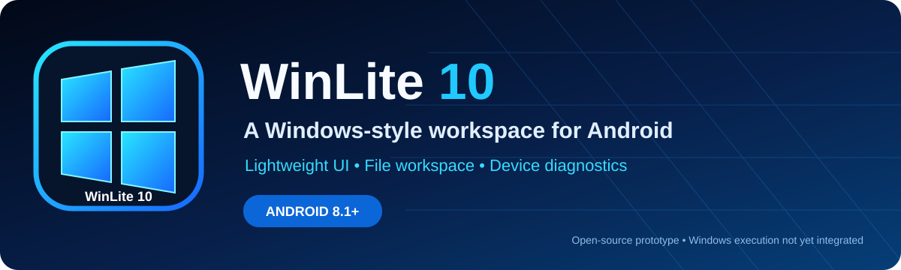

<div align="center">



# WinLite 10

**A lightweight, Windows-inspired Android workspace prototype.**

[](https://developer.android.com/) [](https://kotlinlang.org/) [](https://github.com/xsoftwareabdullah1-create/Winlite10/actions/workflows/android.yml) [](LICENSE)

[Features](#-features) • [Install](#-build-and-install) • [Build APK](#-download-the-apk) • [Roadmap](#-roadmap) • [Limitations](#-important-limitations)

</div>

---

## ✨ About

WinLite 10 is an Android-native project that explores a familiar desktop-style experience on mobile. It includes a Windows-inspired home screen, Start menu, taskbar-like navigation, a private file workspace, settings, and device diagnostics.

The project is a **prototype foundation**, with Android 10 (API 29) as its minimum target. It is not a full Windows emulator, and it does not currently run Windows applications.

## 🚀 Features

| Feature | What it does |
|---|---|
| 🖥️ Desktop-style home | Windows-inspired home screen, Start menu and taskbar-like navigation |
| 📁 Private File Explorer | Browse the app workspace and view file details |
| 📥 Import files | Copy files from Android document picker into the app-private workspace |
| 📂 Folder management | Create folders and delete workspace items with confirmation |
| ⚙️ Settings | Switch between dark and light themes |
| 📱 Device diagnostics | View Android version, model, supported CPU ABIs and memory information |
| 🧪 Compatibility page | Shows which Windows-compatibility components are not yet integrated |
| ☁️ Cloud build | GitHub Actions runs unit tests and attempts a debug APK build |

## 🎨 Branding

- Project logo: [assets/winlite10-logo.svg](assets/winlite10-logo.svg)
- README hero banner: [assets/winlite10-banner.svg](assets/winlite10-banner.svg)

## 📲 Build and install

### Option A — Download a CI APK

1. Open [GitHub Actions workflow runs](https://github.com/xsoftwareabdullah1-create/Winlite10/actions/workflows/android.yml).
2. Open the latest **successful** run.
3. Under **Artifacts**, download **WinLite10-APK**.
4. Extract the artifact ZIP; it should contain WinLite10.apk and SHA256SUMS.txt.
5. Install the APK on Android. Only enable installation permission for the trusted app used to open the APK, and disable it again afterwards.

**Note:** A workflow run can fail. Download the APK only from a successful run where the artifact is present.

### Option B — Build from source

Requirements: JDK 17, Android SDK platform 35, and Gradle 8.9.

```bash
gradle --no-daemon testDebugUnitTest
gradle --no-daemon assembleDebug
```

If the build completes, the debug APK should be at app/build/outputs/apk/debug/app-debug.apk.

## 📋 System requirements

- Android 10 or later (API 29+).
- Available storage for the app and files you import.
- Performance depends on the device and Android version.

## 🧭 Roadmap

- [x] Android-native desktop-style shell
- [x] Private workspace and basic folder/file actions
- [x] Theme toggle and device diagnostics
- [x] GitHub Actions build workflow
- [x] SVG project logo and README banner
- [ ] Improve tablet and landscape layouts
- [ ] Add workspace export/backup
- [ ] Evaluate integrating a compatible Wine runtime, Linux userspace, and ARM64 CPU translation backend
- [ ] Validate Windows-compatibility runtime on Android 10+ devices

## 🧯 Crash diagnostics and EXE Runner status

The app now catches startup errors from its initial screen and displays a basic diagnostic message; details are also written to Android Logcat with the tag `WinLite10`. This is a diagnostic safeguard, not proof that every crash is fixed. If it still stops, open **View summary** on the Android crash dialog or capture the `FATAL EXCEPTION` stack trace and share it so the exact cause can be identified.

The **EXE Runner** page is currently a runtime-readiness screen. It does not launch Windows executables because the Wine/userspace/CPU translation backend is not yet integrated.

## ⚠️ Important limitations

**Windows EXE/MSI execution is not implemented.** The app can select an EXE/MSI file and show a notice, but it does not execute it. Wine, a Linux userspace, Box86/Box64 (or another translation layer), Windows C: drive mapping, and a Windows desktop runtime are not bundled in this milestone. Do not treat this prototype as a working Windows emulator.

The workspace is stored in private app storage. Uninstalling the app or clearing its data may permanently remove imported files. Keep separate copies of important data.

## 🛠️ Technology

- Kotlin and native Android UI
- Android Gradle Plugin 8.7.3
- Gradle 8.9 in CI
- JDK 17
- GitHub Actions

## 🤝 Contributing

Issues and pull requests are welcome. Include device model, Android version, steps to reproduce, and relevant build logs when reporting a bug. Never post passwords, API keys, or other secrets.

## 📄 License

Released under the [MIT License](LICENSE).

---

<div align="center">
**WinLite 10 — a small Android prototype with a desktop-inspired vision.**

[Repository](https://github.com/xsoftwareabdullah1-create/Winlite10) · [Actions / APK artifacts](https://github.com/xsoftwareabdullah1-create/Winlite10/actions) · [Issues](https://github.com/xsoftwareabdullah1-create/Winlite10/issues)
</div>